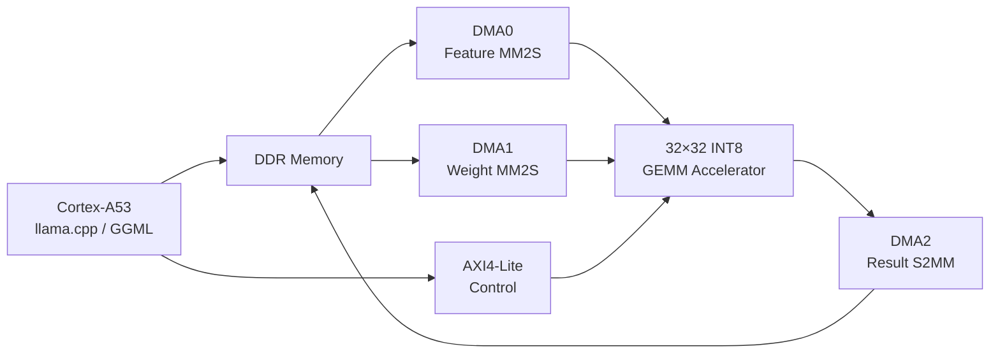
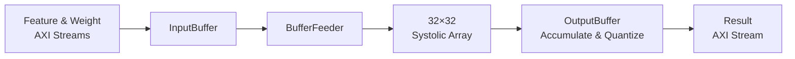

# Shape-Aware 32×32 INT8 GEMM Accelerator for Kria KV260

[](https://www.amd.com/en/products/system-on-modules/kria/k26/kv260-vision-starter-kit.html)
[](https://en.wikipedia.org/wiki/Verilog)
[](https://www.amd.com/en/products/software/adaptive-socs-and-fpgas/vivado.html)
[](#hardware-specifications)
[](https://github.com/ggml-org/llama.cpp)
[](#project-status)

A hardware–software framework for accelerating general matrix multiplication and selected large-language-model workloads on the **AMD Kria KV260**.

The system combines a **32×32 weight-stationary systolic array**, signed INT8 arithmetic, AXI4-Stream interfaces, three AXI DMA engines, Linux coherent DMA buffers, and a shape-aware `llama.cpp` integration path.

The accelerator selectively offloads computationally significant prefill GEMMs to programmable logic while unsupported or low-efficiency operations execute through a deterministic CPU fallback path.

> **Research scope:** This repository contains an educational and research-oriented prototype. It is not a production-ready, fully verified inference platform.

## Highlights

- 32×32 weight-stationary systolic array
- 1,024 parallel processing elements
- Signed INT8 feature and weight operands
- Signed 16-bit multiplication
- 21-bit partial sums inside the processing array
- 32-bit accumulation across K blocks
- Arithmetic right shift, rounding, and INT8 saturation
- Two 256-bit AXI4-Stream input interfaces
- One 256-bit AXI4-Stream output interface
- AXI4-Lite configuration and status interface
- Three independent AXI DMA engines
- Bare-metal hardware verification on the KV260
- Linux coherent DMA-buffer driver
- Selective integration with `llama.cpp` and GGML
- Persistent packed-weight caching
- Shape-aware FPGA admission policy
- Deterministic CPU fallback
- Golden-model comparison utilities

## System Overview



The Processing System configures the accelerator and DMA engines through AXI4-Lite. Feature and weight matrices are transferred from DDR through two independent MM2S channels. Results are returned to DDR through a dedicated S2MM channel.

## Accelerator Architecture


The accelerator processes the tiled matrix multiplication:

```text
C[M, N] = A[M, K] × B[K, N]
```

The hardware array dimension is fixed at 32. The K and N dimensions are represented as groups of 32 elements:

```text
k_block_count = ceil(K / 32)
n_block_count = ceil(N / 32)
```

Dimensions that are not multiples of 32 must be zero-padded by software.

### Internal Dataflow



The main internal blocks are:

| Block | Responsibility |
|---|---|
| `GEMM_top` | Top-level AXI4-Lite and AXI4-Stream integration |
| `GEMM_core` | Configuration freezing and datapath integration |
| `In_buffer` | Storage and replay of feature and weight streams |
| `Buffer_feeder` | Weight loading and feature-row scheduling |
| `Gemm_compute_core` | Compute-pipeline control and result alignment |
| `PE_array` | 32×32 weight-stationary processing-element array |
| `PE_row` | One row of processing elements |
| `PE` | Signed multiply-accumulate processing element |
| `Out_buffer` | Inter-tile accumulation and output sequencing |
| `Right_shifter` | Output shift, rounding, and INT8 saturation |
| `Signed_adder` | Lane-wise signed saturating addition |

## Weight-Stationary Dataflow

During each hardware tile:

1. A 32×32 weight tile is loaded into the processing-element array.
2. Each processing element stores one signed INT8 weight.
3. Feature values propagate horizontally through the array.
4. Partial sums propagate vertically.
5. The array produces 32 output lanes for each feature row.
6. Partial results from multiple K blocks are accumulated.
7. The accumulated values are shifted and saturated to signed INT8.

Each processing element performs:

```text
partial_sum_out = delayed_partial_sum_in
                + feature_value × stored_weight
```

## Hardware Specifications

| Item | Current implementation |
|---|---|
| Target platform | AMD Kria KV260 |
| Device | K26, `xck26-sfvc784-2LV-c` |
| Tool flow | Vivado and Vitis 2022.2 |
| PL clock | 100 MHz |
| Array architecture | 32×32 weight-stationary |
| Processing elements | 1,024 |
| Feature data type | Signed INT8 |
| Weight data type | Signed INT8 |
| Product width | Signed 16-bit |
| PE partial-sum width | Signed 21-bit |
| Inter-tile accumulation | Signed 32-bit |
| Stream width | 256 bits |
| Values per stream beat | 32 INT8 values |
| Theoretical peak compute | 102.4 GMAC/s |
| Peak operations | 204.8 GOPS when multiply and add are counted separately |

The theoretical peak rate assumes that all 1,024 processing elements perform one multiply-accumulate operation per 100 MHz clock cycle.

## Compute-Pipeline Latency

The current compute pipeline uses the following constants:

```text
Multiplier latency = 1 cycle
PE total latency   = 2 cycles
Result latency     = 2 × array_rows + array_columns
```

For the 32×32 array:

```text
Result alignment latency = 2 × 32 + 32 = 96 cycles
```

If the multiplier IP configuration changes, the valid and last-signal alignment logic must be updated and reverified.

## AXI Interfaces

| Interface | Direction at GEMM | Width | Purpose |
|---|---|---:|---|
| AXI4-Lite | Slave | 32-bit | Configuration and status |
| Feature AXI4-Stream | Slave | 256-bit | Matrix A input |
| Weight AXI4-Stream | Slave | 256-bit | Matrix B input |
| Result AXI4-Stream | Master | 256-bit | Matrix C output |

Each AXI4-Stream beat contains 32 signed INT8 lanes:

```text
Lane 0  → TDATA[7:0]
Lane 1  → TDATA[15:8]
...
Lane 31 → TDATA[255:248]
```

Feature and weight transfers must use full beats:

```text
TSTRB = 32'hFFFF_FFFF
```

`TLAST` must be asserted only on the final beat of the complete feature or weight stream.

## AXI Address Map

| Block | Function | Base address |
|---|---|---:|
| GEMM IP | Configuration and status | `0xA0000000` |
| DMA0 | Feature input, MM2S | `0xA0010000` |
| DMA1 | Weight input, MM2S | `0xA0020000` |
| DMA2 | Result output, S2MM | `0xA0030000` |

The corresponding Vitis macros are:

```c
#define GEMM_BASE_ADDR    XPAR_GEMM_DSP_IP_0_BASEADDR
#define FEATURE_DMA_ADDR  XPAR_AXI_DMA_0_BASEADDR
#define WEIGHT_DMA_ADDR   XPAR_AXI_DMA_1_BASEADDR
#define RESULT_DMA_ADDR   XPAR_AXI_DMA_2_BASEADDR
```

Do not edit `xparameters.h` manually. After changing the Vivado block design or address map, regenerate the bitstream, export the hardware platform, and rebuild the Vitis platform.

## GEMM Register Map

| Offset | Register | Description |
|---:|---|---|
| `0x00` | `SHIFT_STATUS` | Output shift, clear request, and job status |
| `0x04` | `ROW_COUNT` | Number of M rows |
| `0x08` | `K_BLOCK_COUNT` | Number of 32-element K blocks |
| `0x0C` | `N_BLOCK_COUNT` | Number of 32-column N blocks |

### `SHIFT_STATUS` Fields

| Bits | Name | Description |
|---:|---|---|
| `[9:0]` | `shift` | Arithmetic right-shift value |
| `[16]` | `clear_done` | Request status clearing while idle |
| `[24]` | `busy` | A hardware job is active |
| `[25]` | `done` | Final result beat has been accepted |
| `[26]` | `idle` | Accelerator is idle |
| `[27]` | `clear_accepted` | Clear request accepted |
| `[28]` | `clear_busy_error` | Clear attempted while busy |

The accelerator does not use a separate start register. A job becomes active when the first feature or weight stream beat is accepted.

## Stream Layout

### Feature Matrix

Feature data are transferred in row-major K-block order:

```text
for row = 0 .. row_count - 1
    for k_block = 0 .. k_block_count - 1
        send one 256-bit feature beat
```

The number of feature beats is:

```text
feature_beats = row_count × k_block_count
```

### Weight Matrix

Weight data are transferred in K-block, K-lane, and N-block order:

```text
for k_block = 0 .. k_block_count - 1
    for k_lane = 0 .. 31
        for n_block = 0 .. n_block_count - 1
            send one 256-bit weight beat
```

The number of weight beats is:

```text
weight_beats = k_block_count × 32 × n_block_count
```

### Result Matrix

Results are emitted in row-major N-block order:

```text
for row = 0 .. row_count - 1
    for n_block = 0 .. n_block_count - 1
        receive one 256-bit result beat
```

The number of result beats is:

```text
result_beats = row_count × n_block_count
```

## Capacity Constraints

| Constraint | Current limit |
|---|---:|
| `row_count` register | 9 bits, maximum 511 |
| `k_block_count` register | 5 bits, maximum 31 |
| `n_block_count` register | 5 bits, maximum 31 |
| Feature-buffer condition | `row_count × k_block_count ≤ 2400` |
| Weight-buffer condition | `k_block_count × 32 × n_block_count ≤ 2400` |
| Output-buffer condition | `row_count × n_block_count ≤ 2400` |

Larger matrices are divided into multiple hardware jobs by software.

## Required DMA Start Order

The result DMA must be ready before the accelerator starts producing output:

```text
1. Wait until the GEMM accelerator is idle.
2. Clear the previous done status if necessary.
3. Configure the GEMM registers.
4. Prepare and synchronize the DMA buffers.
5. Start DMA2 S2MM for the result.
6. Start DMA0 MM2S for feature data.
7. Start DMA1 MM2S for weight data.
8. Wait for all three DMA channels.
9. Wait for GEMM completion.
10. Synchronize or invalidate the result buffer.
11. Compare or consume the output.
```

Starting the two MM2S input channels before the S2MM result channel can cause the output path to stall.

## Implementation Results

The documented implementation results for the 100 MHz KV260 design are:

| Resource | Used | Available | Utilization |
|---|---:|---:|---:|
| LUT | 39,781 | 117,120 | 33.97% |
| Flip-flop | 85,656 | 234,240 | 36.57% |
| BRAM | 111 | 144 | 77.08% |
| URAM | 8 | 64 | 12.50% |
| DSP48E2 | 1,025 | 1,248 | 82.13% |

Timing result:

```text
Worst Negative Slack (WNS) = +3.055 ns
```

These results correspond to the documented implementation configuration and should be regenerated after changing the RTL, IP configuration, clock frequency, or Vivado design.

## Bare-Metal Verification

A 32×32 signed INT8 hardware test has been verified using three AXI DMA channels.

Test configuration:

```text
shift         = 0
row_count     = 32
k_block_count = 1
n_block_count = 1

Feature bytes = 1024
Weight bytes  = 1024
Result bytes  = 1024
```

Expected successful output:

```text
DMA0 feature done, status=0x00001002
DMA1 weight done, status=0x00001002
DMA2 result done, status=0x00001002
GEMM done, status=0x06000000
Hardware GEMM done
COMPARE PASS
```

`COMPARE PASS` confirms that the hardware output matches the software reference for the verified 32×32 test case.

## Linux Integration

The Linux execution path uses:

| Component | Current environment |
|---|---|
| Operating system | Ubuntu 22.04.4 LTS |
| Kernel | `5.15.0-1027-xilinx-zynqmp` |
| Processor | Four Cortex-A53 cores at 1.333 GHz |
| FPGA deployment | KV260 FPGA overlay |
| Device interface | `/dev/gemm_dma_buf` |
| Runtime | Modified `llama.cpp` and GGML |

The custom kernel module allocates coherent buffers for the feature, weight, and result matrices.

Documented buffer capacities are:

| Buffer | Role | Capacity |
|---|---|---:|
| A | Feature/activation input | 64 MiB |
| B | Packed-weight input | 400 MiB |
| C | Result output | 64 MiB |

Normal heap pointers must not be programmed directly into the DMA engines. DMA transfers must use addresses returned by the coherent-buffer driver.

## Shape-Aware `llama.cpp` Offload

The FPGA path is integrated into:

```cpp
ggml_compute_forward_mul_mat()
```

The integration evaluates tensor type, dimensions, memory layout, alignment, hardware availability, and expected offload efficiency before submitting a GEMM to the FPGA.

### Supported Quantized Weight Types

- `Q5_0`
- `Q8_0`
- `Q4_K`

Weights are dequantized when required and requantized into the accelerator’s signed INT8 layout. Packed weights are retained in a persistent cache to reduce repeated preparation overhead.

### Current Model-Specific Policy

| Condition | Current policy |
|---|---|
| Evaluated model | Qwen2.5-0.5B-Instruct-Q4_K_M |
| Inner dimension | `K = 896` |
| Prefill threshold | `M ≥ 32` |
| Decode shape | `M = 1`, retained on CPU |
| Maximum M chunk | 64 rows |
| Maximum N tile | 64 columns |
| Evaluated N scope | Up to 4,864 columns |
| Unsupported operation | Deterministic CPU fallback |

The selective policy targets GEMMs whose computational workload is large enough to amortize data preparation, DMA setup, synchronization, programmable-logic execution, and output-restoration overhead.

## Measured End-to-End Throughput

The following results are documented for Qwen2.5-0.5B-Instruct-Q4_K_M on the KV260:

| Workload | CPU-only prefill | CPU+FPGA prefill | Prefill speedup | CPU-only decode | CPU+FPGA decode |
|---|---:|---:|---:|---:|---:|
| P32-N64 | 8.64 tok/s | 18.84 tok/s | 2.18× | 5.90 tok/s | 5.64 tok/s |
| P128-N64 | 8.65 tok/s | 25.07 tok/s | 2.90× | 5.88 tok/s | 5.70 tok/s |
| P512-N64 | 8.53 tok/s | 24.12 tok/s | 2.83× | 5.87 tok/s | 5.67 tok/s |

Large-M prefill operations benefit from FPGA execution. Decode GEMMs typically have `M = 1`, where transfer and setup overhead dominate, so they remain on the CPU under the selective policy.

The reported operator-level mean absolute error for the evaluated offloaded operations is approximately:

```text
MAE ≈ 0.0108–0.0137
```

Results should be interpreted within the documented model, board, software version, prompt configuration, and measurement methodology.

## Repository Structure

```text
GEMM_32x32_KV260_AI_ACCELERATOR/
├── rtl/                         # GEMM datapath and systolic-array RTL
│   ├── GEMM_top.v
│   ├── GEMM_core.v
│   ├── Gemm_compute_core.v
│   ├── In_buffer.v
│   ├── Buffer_feeder.v
│   ├── Out_buffer.v
│   ├── PE_array.v
│   ├── PE_row.v
│   ├── PE.v
│   ├── Right_shifter.v
│   └── Signed_adder.v
├── axi_ip/                      # AXI4-Lite and AXI4-Stream adapters
│   ├── Control_register_file.v
│   ├── Feature_stream_slave.v
│   ├── Weight_stream_slave.v
│   └── Result_stream_master.v
├── software/
│   ├── FPGA/                    # FPGA runtime and standalone tests
│   ├── ggml-cpu/                # Modified GGML CPU integration
│   ├── ggml-src/                # GGML build integration
│   └── llama.cpp/               # llama.cpp source tree and integration
├── linux/ubuntu/                # Coherent DMA-buffer kernel driver
├── golden_model/                # Reference-output comparison utility
├── address_map/                 # Verified AXI address map
├── TOP_DOWN_SYSTEM/             # Architecture figures
└── docs/
    ├── README.md
    ├── architecture.md
    ├── programming-model.md
    ├── baremetal-bringup.md
    ├── linux-llama-integration.md
    ├── module-signal-reference.md
    └── rtl-module-reference.md
```

## Documentation

Detailed documentation is available in the `docs` directory:

- [Documentation overview](docs/README.md)
- [Hardware architecture](docs/architecture.md)
- [Software programming model](docs/programming-model.md)
- [Bare-metal bring-up guide](docs/baremetal-bringup.md)
- [Linux and llama.cpp integration](docs/linux-llama-integration.md)
- [RTL module reference](docs/rtl-module-reference.md)
- [Module and signal reference](docs/module-signal-reference.md)
- [Current AXI address map](address_map/ADDRESS_MAP_GEMM_32x32_KV260_CURRENT.md)

## Golden-Model Comparison

The `golden_model` directory contains a Python utility for comparing accelerator output against a reference result:

```bash
python3 golden_model/compare_gemm_txt.py
```

Before using the script, confirm that its input paths and matrix dimensions match the current test configuration.

## Development Workflow

A safe bring-up sequence is:

1. Verify RTL behavior in simulation.
2. Generate the Vivado bitstream.
3. Export the matching hardware platform.
4. Rebuild the Vitis platform and bare-metal application.
5. Run the AXI4-Lite smoke test.
6. Run the verified 32×32 GEMM comparison.
7. Require `COMPARE PASS` before testing larger matrices.
8. Load the Linux FPGA overlay.
9. Load the coherent DMA-buffer kernel module.
10. Run a small Linux GEMM comparison.
11. Enable `llama.cpp` comparison mode.
12. Enable selective FPGA output only after numerical validation passes.

Keep the verified 32×32 test as a regression baseline and change one subsystem at a time.

## Common Failure Modes

| Symptom | Likely cause |
|---|---|
| AXI4-Lite access hangs | PL clock/reset or PS–PL initialization problem |
| DMA reports an error | Invalid address, length, direction, or channel state |
| DMA completes but output is stale | Incorrect buffer mapping or cache synchronization |
| Hardware completes with incorrect values | Packing, shift, scale, padding, or layout mismatch |
| GEMM `done` does not assert | Final result beat was not accepted |
| Decode throughput decreases | Small-M GEMMs were admitted despite high offload overhead |
| No FPGA calls are observed | Shape, quantization, layout, or hardware-readiness check failed |

## Project Status

This repository represents a functional research prototype with:

- synthesizable Verilog RTL;
- a verified 32×32 bare-metal GEMM baseline;
- a Linux coherent DMA-buffer path;
- a modified `llama.cpp`/GGML integration;
- shape-aware selective offloading;
- CPU fallback; and
- documented end-to-end performance measurements.

Current areas for further development include:

- broader operator-level numerical validation;
- end-to-end perplexity and task-accuracy evaluation;
- automated RTL and software regression tests;
- continuous-integration workflows;
- support for additional models and tensor shapes;
- reduction of host-side packing and transfer overhead;
- improved small-M execution efficiency; and
- expanded hardware portability beyond the KV260.

## Contributing

Issues, verification improvements, documentation corrections, and hardware/software enhancements are welcome.

For substantial changes:

1. Open an issue describing the intended behavior.
2. Keep RTL and software changes focused and modular.
3. Include a reproducible simulation or hardware test.
4. Report the tested board, tool version, clock, matrix shape, and data type.
5. Confirm that the verified 32×32 regression still produces `COMPARE PASS`.

## Author

Developed by [nguyen-ky2910](https://github.com/nguyen-ky2910) as a research and educational project in FPGA-based AI acceleration, systolic-array architecture, heterogeneous CPU–FPGA execution, and edge LLM inference.

## License

A repository-level license is not currently included.

The repository also contains third-party source code, including `llama.cpp`, which remains subject to its own license and copyright notices. Add a root-level license before distributing or reusing the original accelerator code, and preserve all third-party license files and attribution requirements.
